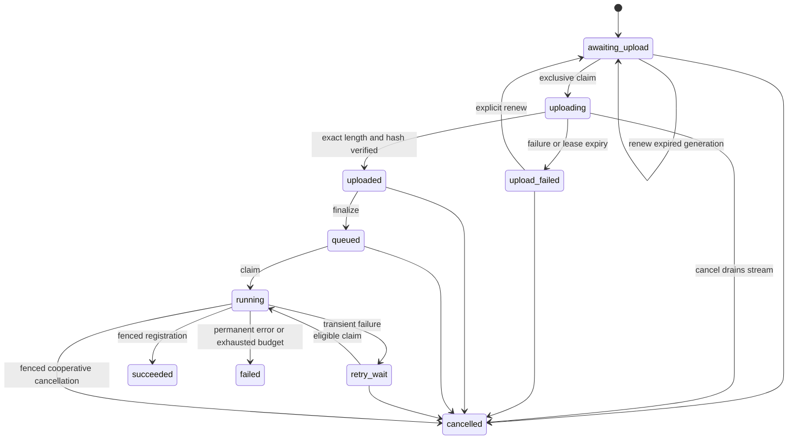

# V2 Phase 1: contracts and compatibility design

Approved documentation milestone, October 28, 2026. The user's instruction to
implement the reviewed Phase 1 scope authorizes this contract, its companion
matrices, read-only baseline inspection, and Phase 1 authority/status updates.
It does not authorize implementing Phases 2–9, changing running services,
committing/pushing, purchases, downloads, model execution, or deployment.

The normative words **must** and **reject** below specify future implementation.
They do not describe capabilities delivered by Phase 1. Measured inspection and
review outcomes belong in [verification](phase-1-verification.md); acceptance
design belongs in [acceptance matrix](acceptance-matrix.md). Earlier R1–R9 and UI
records remain historical evidence. This document supersedes none of their
completed numerical, integrity, or preservation guarantees.

## 1. Goal, sequence, and explicit boundaries

Deliver a bounded spot-crypto trade research platform whose supported instruments,
venues, and dates can change through validated metadata and imports rather than
source edits. Phase 2 generalizes ingestion; Phase 3 analytics/research; Phase 4
UI/uploads; Phase 5 copilot/memos; Phase 6 object storage; Phase 7 multi-host worker
pools; Phase 8 separate authenticated customer stacks; Phase 9 integrated handoff.
Each phase needs its own implementation approval and observed acceptance.

Only canonical trades and the existing three descriptive workflows are included.
No equities/calendars/corporate actions, derivatives, arbitrary tables, OHLCV-only
inputs, streaming, currency conversion, automatic venue consolidation, forecasts,
strategies, backtesting, column mapping, public signup, billing, Kubernetes,
automatic GC, or splitting one research run among hosts. Independent jobs can
execute concurrently on different workers. Catalog growth does not raise per-job
bounds. Existing local operation remains supported.

## 2. Current source facts and change inventory

Baseline source is recorded in verification, including dirty/untracked overlay.
These inspected facts are constraints to design around, not new test results:

| Area | Current restriction/assumption | Future change owner |
| --- | --- | --- |
| `datasets/source.py`, `datasets/jobs.py` | Binance, BTCUSDT/ETHUSDT, January 2025, 62 jobs | Phase 2 |
| migration `0004_ingestion_jobs` | Database CHECKs also enforce original venue/symbol/month | Phase 2 forward migration |
| `datasets/normalize.py`, `publication.py` | Seven-column Binance parser; int64 numeric IDs; fixed schema/transform; filesystem paths/rename | Phases 2, 6 |
| `analytics/bars.py`, `routes.py`, `schemas.py` | Fixed symbols/month; timestamp then numeric ID OHLC ordering | Phase 3 |
| `research/spec.py`, `service.py` | Fixed scope, 5m, 62 versions, 17,856 buckets, local publication | Phases 3, 6 |
| `workspace.py`, frontend forms/client/chart | Fixed filter/validation bounds; local origin policy | Phases 4, 8 |
| frontend catalog/UI helpers | Much display already comes from registered metadata | Phase 4 preserve/generalize |
| copilot spec/model | BTC/ETH recognition/schema and January prompt context | Phase 5 |
| memo facts/renderer | Fixed symbols and USDT-oriented units; independent numerical reads | Phase 5 |
| Settings/Compose | One local storage root; no customer authentication contract | Phases 6–8 |

Retain the independent synthetic `/trades` subsystem and its exact-ID, import,
pagination, timestamp, decimal, CLI, and error contracts. It does not become a
shortcut into the analytical catalog. Retain R1 checksum-before-parse and full
readback; R2 leases/fencing/retry; R3 arithmetic/cache/cancellation; R4 numerical
definitions; R5 safe handoff; R6 supplemental memo independence; later source and
actual-model protections. The [compatibility matrix](compatibility-matrix.md)
defines which persisted versions can execute.

## 3. Registry and semantic identity (Phase 2)

Use `instrument_id = <venue_id>:spot:<source_symbol>` as an opaque API identifier.
`venue_id` is operator-created lowercase ASCII `[a-z][a-z0-9_]{0,31}`;
`source_symbol` is case-sensitive ASCII `[A-Za-z0-9][A-Za-z0-9._-]{0,63}`. The
separator colon is forbidden inside either component. Base and quote asset codes
are case-sensitive `[A-Z0-9][A-Z0-9._-]{0,31}`; equality means exact asset-code
equality, not peg/economic equivalence. Operators prevent ambiguous asset aliases.

Registry entries contain instrument ID, venue ID, market=`spot`, source symbol,
base asset, quote asset, display name (1–80 UTF-8 characters, no controls),
`trade_id_order` (`numeric` or `utf8`), adapter (`binance_daily` or
`canonical_file`), enabled flag, semantic revision hash, and database timestamps.
Venue display names have the same text bounds. The semantic hash covers every
field except display labels, enabled flag, and timestamps. Base/quote, market,
symbol, ID ordering, and adapter cannot be edited after first publication; wrong
semantics require a new venue/instrument identity and explicit reimport. Labels
may change, but published manifests pin their original metadata snapshot. Disable
prevents new imports; it never hides retained readable artifacts.

Binance entries require operator-verified base/quote metadata; do not split
symbols heuristically. The source adapter constructs only the existing official
archive/checksum URL pattern from validated fields. A missing archive fails that
daily job; never substitute another venue/day/provider. Provider-supported scope
does not assert that every archive exists. Generalized supported dates are
1970-01-01 through 9999-12-30 inclusive; the last date permits an exclusive
following-day boundary. Future dates are rejected at admission using UTC server
time; completed past UTC days only for Binance. Canonical files may cover the
current UTC day and explicitly describe partial observed data.

## 4. Canonical files, provenance, and normalization (Phase 2)

One import file represents one registered instrument and one declared UTC day.
Large histories are submitted as daily files; do not accept arbitrary layouts.
Accept uncompressed UTF-8 CSV (optional UTF-8 BOM) or Parquet, not ZIP wrappers for
canonical files. Binance retains its exact ZIP/checksum pipeline. CSV has exactly
these unique header names, in any order, and no extra columns:

```csv
source_trade_id,executed_at,price,quantity,quote_quantity,is_buyer_maker,is_best_match
42,2025-03-01T00:00:00.123456Z,1.250000000000000000,2.000000000000000000,2.500000000000000000,,
```

| Field | Input and normalized meaning |
| --- | --- |
| `source_trade_id` | Nonempty ASCII `[A-Za-z0-9._:-]{1,128}`. Numeric mode requires canonical unsigned decimal text in 0..2^63−1; UTF-8 mode compares exact ASCII bytes. No case folding or leading-zero normalization. |
| `executed_at` | CSV uses the manifest-declared encoding: RFC3339 with explicit UTC `Z`/`+00:00`, or canonical integer Unix seconds/milliseconds/microseconds. Convert exactly to UTC microseconds; reject finer precision, overflow, absent zones, and values outside the declared day. |
| `price`, `quantity` | Positive plain decimal text, at most 20 integer and 18 fractional digits; no exponent, float, sign, NaN, rounding, or locale separators. Normalize decimal128(38,18). |
| `quote_quantity` | Required supplied positive decimal with the same precision contract. Never substitute price×quantity: provider quote quantities may have their own exact semantics. |
| maker/match flags | CSV exactly `true`, `false`, or empty. Parquet bool or null. Null means unavailable, never false. |

Parquet requires exactly the same columns: source ID string, timestamp(us, UTC),
decimal128(38,18) price/quantity/quote quantity, nullable booleans. Quote quantity
cannot be null. Reject floats, implicit casts, nested columns,
dictionary tricks that change logical values, extra columns, and external links.
Parquet manifest timestamp encoding is `arrow_timestamp_us_utc`. Reject unbounded
metadata/row groups before allocation and process bounded batches. CSV quoting
follows the existing strict CSV reader; no embedded record newlines are allowed.

Metadata is strict JSON `canonical-trade-import-v1`, at most 64 KiB, duplicate and
unknown keys rejected. Exactly: `schema`, `instrument_id`, `trade_date`, `format`
(`csv`/`parquet`), `timestamp_encoding`, `quote_quantity_mode`
(exactly `supplied` in this release), `source_sha256` (64 lowercase hex),
`source_name` (1–128 printable characters), `source_reference` (null or 1–2048
printable characters), and `coverage_claim` (`observed_only`). References are
recorded as text and never fetched or rendered as executable links. No metadata
field may supply code, SQL, a model, storage paths, credentials, or remote fetch
URLs. User files have caller-declared and actual byte hashes; unlike Binance's
official checksum they do not prove independent provider authenticity.

Normalized schema `spot-trades-v2` pins registry semantic hash and instrument ID,
stores source ID as string, UTC timestamp, exact decimals, nullable flags, and
quote provenance mode. Logical rows sort by numeric ID or ASCII-byte ID according
to the pinned registry ordering. OHLC ties use `(executed_at, source_trade_id)`
with that same declared comparator. Numeric IDs therefore preserve legacy order.

Canonical logical-row bytes are one compact canonical JSON array plus LF per row
in declared ID order: `[instrument_id,source_trade_id,executed_at,price,quantity,
quote_quantity,is_buyer_maker,is_best_match]`. Timestamp text always has six
fractional digits and `Z`; decimal text has 18 fractional digits; booleans/null
are JSON literals. Source ID remains a string even in numeric mode. The logical
hash covers these exact bytes. Count these bytes before deduplication for the
4 GiB decoded-input bound, preventing repeated-row compression from bypassing it.
Normalized Parquet output is capped at 4 GiB per daily version; manifest and
quality report each at 64 KiB. Reserve that 4 GiB+128 KiB ceiling separately from
retained raw-source storage before normalization, reconciling actual bytes only
after verified completion or owned failure cleanup.

Trade identity is `(instrument_id, source_trade_id)`, not a global unqualified ID.
Within a normalized version, duplicates with identical normalized values collapse
and conflicting values reject publication. Across a research snapshot's selected
daily partitions, repeated identities must agree or selection fails with 409.
Validate this using bounded disk-backed identity checks during preparation. There
is no global uniqueness constraint across all historical versions: corrected
source bytes may publish a new immutable alternative for the same instrument/day,
including corrected values for an old ID. Previous versions remain readable and
unchanged; customers explicitly pin one alternative per instrument/day. Other
venues cannot collide. Failed source bytes remain evidence without altering any
published record. Empty files
are rejected. Requested coverage, observed first/last timestamp, missing buckets,
and provider completeness are separate concepts; no completeness claim is inferred.

## 5. Immutable identity and schema transition (Phases 2–3)

Keep all legacy IDs and artifacts byte-for-byte. New generalized datasets use
`dataset-manifest-v2` and a SHA-256 identity over canonical UTF-8 JSON of: source
byte hash, canonical metadata hash excluding source display/reference text,
instrument semantic hash, UTC day, normalized schema version, transform version,
and dependency-lock hash. Operational job IDs, tenant IDs, storage location,
retrieval time, and current Git dirty state are provenance, not identity inputs.
Exact canonical JSON uses sorted keys, compact separators, ASCII escaping, no
nonfinite numbers, and one terminal LF. Do not equate CSV and Parquet source-byte
identities merely because their logical rows match; record logical hash separately.

V2 datasets and durable submissions/jobs/attempts use new tables with
explicit contract versions and foreign keys. Seed legacy instrument mapping using
verified BTC/ETH metadata, but do not update old catalog/manifests or weaken old
CHECKs. Add a read-only catalog union/adaptation layer. This replaces the roadmap's
informal “remove constraints” wording with a forward-compatible design: generalized
tables carry generalized constraints; legacy rows keep their historical checks.
Migration DDL must constrain date ordering, registered instruments, 62 child jobs,
states, attempts, token monotonicity through protocol, ownership, and publication
references. Enforce cross-row cardinality atomically in submission transactions.

Legacy synchronous ingest retains signatures/output and its original allowlist.
Generalized CLI/API uses new contracts; it never silently routes an old request
to a new transform. Same canonical v2 request/idempotency key replays; conflicting
reuse is 409. Keys are namespaced by operation and protocol, scoped to the customer
stack, and persist with request hash. New source bytes require a fresh request key
and create a new immutable version when compatible with trade identity rules.

## 6. Public API and CLI contract (Phases 2–5)

New public resources live under `/v2`. Legacy `/v1` and synthetic endpoints retain
response bodies and error meanings. V2 control bodies are strict UTF-8 JSON ≤64 KiB
unless noted; unknown/duplicate fields fail. IDs are opaque, except version hashes
remain 64 lowercase hex. List pages default 25, max 100, opaque cursor ≤2048 bytes
bound to endpoint/filters/order. Cursors provide current-committed traversal, not a
snapshot. JSON responses contain decimal strings, exact integer counts, and UTC
timestamps. Mutations require `Idempotency-Key` with `[A-Za-z0-9_.-]{1,128}`.

| Interface | Required behavior |
| --- | --- |
| `GET /v2/capabilities` | Version, supported schema/adapter/workflow/interval lists, effective limits, auth mode, storage mode; no secrets or private endpoint URLs. |
| `GET /v2/instruments` and `/{instrument_id}` | Registry metadata, enabled/readable state, adapter capability; list filter by venue/base/quote. |
| `POST /v2/instruments` | Operator-only strict registry entry; 201 new, 200 identical key replay; conflicting semantics 409. Semantic edits/deletion unsupported. |
| `PATCH /v2/instruments/{id}` | Operator-only `display_name` and/or `enabled`, expected registry revision required; 409 stale. |
| `GET /v2/datasets` and `/{version}` | Union of readable versions with contract/format/provenance; explicit instrument/day filters; detail verifies registered artifacts. |
| `GET /v2/coverage` | One instrument and bounded `[from_date,before_date)` ≤62 days; lists registered daily versions, gaps, observed bounds, and observed-only disclaimer. Does not choose between alternatives. |
| `POST /v2/ingestion/submissions` | `daily-ingestion-v2`, adapter=`binance_daily`, instrument IDs (1..2), dates, key; Cartesian daily partitions ≤62. Returns durable submission/jobs. |
| `POST /v2/imports` | Canonical manifest plus exact `content_length`; reserves quota and creates staged import and upload capability. Returns import ID, expiry, exact upload destination. |
| `PUT /v2/imports/{id}/content` | Bounded API-proxied raw stream for both local and object backends, requires import-scoped one-use token plus authenticated creator. Atomically claim generation before reading, enforce exact declared length and SHA-256, exclusive write to a server-generated destination. No direct customer S3 PUT, paths, overwrite, or resumable chunks. |
| `POST /v2/imports/{id}/upload` | Expected import revision; issue a fresh generation only for an unfinalized import after prior generation expiry/failed upload, retiring its old capability. Never mutate finalized content. |
| `POST /v2/imports/{id}/finalize` | Recheck length/hash and immutable staging generation, enqueue one daily durable job. 201 accepted, 200 replay; partial/wrong bytes 409/422. |
| `POST /v2/imports/{id}/cancel` | Body exactly `{expected_revision:<integer>}` plus idempotency key. Before finalize, atomically cancel the import/generation and stop/drain its stream. After finalize, submit the same durable cancellation request as the linked job route. Terminal success/failed returns 409; cancelled replay returns 200. |
| `GET /v2/imports/{id}`, `GET /v2/ingestion/submissions/{id}` | State, jobs/attempts, safe errors, counters, published versions; no raw records/credentials/storage capabilities. |
| `POST /v2/jobs/{id}/cancel` | Owner/operator request, expected revision; cooperative cancellation with publication/cancellation serialized under job lock. Already successful returns 409, repeated accepted request 200. |
| `GET /v2/bars` | Instrument ID, repeated pinned version, interval, aligned start/end; existing chart bounds. |
| `POST /v2/research/runs` | `research-spec-v2`, pinned selection, existing workflow/metrics/predicates; durable creation independent of memo. |
| `GET /v2/research/runs/{id}` and `/{id}/results`, `/{id}/summary` | Status and independently verified numerical outputs; original run protocol identified. |
| `POST /v2/copilot/requests`, `GET /{id}`, `POST /{id}/clarifications` | V2 instrument context and selected versions; retain expected-revision replay/conflict rules and five-answer maximum. |
| `POST /v2/research/runs/{id}/memo`, `GET /v2/research/runs/{id}/memo` | Idempotent supplemental enqueue/read; no reset of terminal jobs or user-supplied prompt/model. |

GET responses are 200; absent resources 404. POST durable create returns 201 and
`{id,state,replayed:false}`; same-key replay returns 200/replayed true. Validation
422; unsupported media 415; body too large 413; state/key/coverage conflict 409;
quota/admission 429 with bounded Retry-After; unavailable catalog/storage/model
503; bounded execution deadline 504. Safe error envelope is
`{"error":{"code":"coverage_gap","message":"Registered coverage is incomplete.","request_id":"<opaque>"}}`.
Codes are fixed allowlisted values; never echo raw records, SQL, secrets, paths,
untrusted metadata, or exception strings. No new remote endpoint is advertised
before the phase delivering it.

Example future import metadata (`<64 lowercase hex>` is a placeholder replaced by
the real file hash before submission):

```json
{"schema":"canonical-trade-import-v1","instrument_id":"example_spot:spot:SOLUSD","trade_date":"2025-03-01","format":"csv","timestamp_encoding":"rfc3339_utc","quote_quantity_mode":"supplied","source_sha256":"<64 lowercase hex>","source_name":"operator-export","source_reference":null,"coverage_claim":"observed_only"}
```

The example venue is synthetic and asserts no provider availability. A future
`research-spec-v2` replaces `symbols` with `instrument_ids`; otherwise retains the
exact v1 fields, metrics, empty parameters, predicates, and UTC semantics. Version
IDs alone select exactly one version per touched instrument/day. Explicit selection
of two alternatives for the same day is 409. Both instruments must have the same
quote asset for cross-asset research; never equate USD and USDT.

The create-import body is exactly `{ "manifest": <canonical metadata object>,
"content_length": <positive integer> }`. Its response is
`{"id":"<uuid>","state":"awaiting_upload","revision":0,"replayed":false,"upload":{"method":"PUT","url":"<opaque destination>","generation":"<uuid>","expires_at":"<UTC>","required_headers":{}}}`.
Required upload headers contain the generated one-use upload token, exact
Content-Length, and content type. Clients cannot choose object keys. The URL
always targets this stack's API proxy, never S3. Finalize body is exactly
`{"expected_revision":2,"generation":"<uuid>"}`;
status returns current revision, state, declared/received bytes, source hash,
nullable submission/job/version IDs, and nullable safe error. States are
awaiting_upload/uploading/upload_failed/uploaded/queued/running/retry_wait/succeeded/failed/cancelled.
Every durable transition increases revision by one: create=0, exclusive upload
claim=1, verified upload=2, finalize/queued=3. State response returns the current
revision; examples do not authorize guessing it. Uploaded means exact declared
bytes/hash accepted, not normalization or independent authenticity.
The storage upload generation, canonical expected bytes, and finalization revision
are rechecked transactionally before durable enqueue. Lost-response finalize
replays its original key even if the current revision has advanced. Upload renewal
body is exactly `{"expected_revision":<current integer>}`. A failed/hash-invalid
stream marks its generation failed and import `upload_failed`; a crashed stream
does the same when its 60s upload lease expires. A 10s heartbeat renews only its
exclusive owner. A failed generation cannot be finalized, resumed or reused. A
renewal creates a new generation, changes state to awaiting_upload, and increases
revision; it requires a fresh quota
reservation while retained bytes from old generations remain charged. Capability
issuance replay returns
the existing generation and original expiry; it never extends access. Expiry
does not delete bytes or release quota.

Allowed import transitions are shown below. A capability expiring before upload
claim leaves the import awaiting_upload with an expired generation; renewal is
allowed there or from upload_failed only. It is forbidden while an upload lease
is valid, after uploaded (finalize or cancel instead), after finalize, and in any
terminal state. Succeeded/failed/cancelled are terminal and cannot be renewed or
reset. A normalization/integrity failure after finalize is terminal failed;
upload_failed is only a retriable pre-finalize transport/generation state. Exact
same-key replays return their original operation outcome without restoring a
retired capability or changing current state. Fresh creation is required after
terminal failure. Every transition and linked-job projection increases the import
revision under the same locked import row. For linked canonical imports every
state-changing transaction (finalize, claim/reclaim, retry, cancellation, and
publication) locks import then job then version; claim candidates first lock the
import using SKIP LOCKED, then its job. Heartbeats need only the job lock because
they do not change projected import state/revision. Workers never acquire import
after holding job. Publication rechecks the durable cancellation flag under job
ownership. Non-import jobs retain job-then-version ordering.



Finalization and cancellation serialize under the import row. A cancelled stream
cannot commit uploaded state or enqueue a job; bytes already written remain quota
charged until explicit verified cleanup. After finalize the import's job projection
uses the same job cancellation/publication linearization boundary; no second
independent cancellation state machine can contradict a successful job result.

An official ingestion body is exactly
`{"schema":"daily-ingestion-v2","adapter":"binance_daily","instrument_ids":["binance_spot:spot:SOLUSDT"],"from_date":"2025-03-01","before_date":"2025-03-02"}`.
Dates are UTC and end-exclusive. Instrument creation accepts exactly venue ID,
market, source symbol, base asset, quote asset, display name, ID ordering, and
adapter. Enabled initially defaults true. IDs/hash/time fields are
application-generated and cannot be supplied by customers.

Example generalized research body:

```json
{"schema":"research-spec-v2","workflow":"market_profile","instrument_ids":["binance_spot:spot:SOLUSDT"],"dataset_versions":["<registered 64-hex version>"],"start":"2025-03-01T01:00:00Z","end":"2025-03-02T00:00:00Z","history_start":"2025-03-01T00:00:00Z","interval":"5m","metrics":["profile"],"parameters":{},"predicates":{}}
```

The placeholder is resolved through catalog selection, never generated by a model.
Research create returns `{id,state,replayed}`; polling status includes the immutable
spec, contract identity, attempt count, nullable safe error, and numerical/memo
availability separately. Dataset lists return `{items,next_cursor}`; instrument
records carry the registry fields above; coverage returns
`{instrument_id,from_date,before_date,days:[{date,versions,observed_start,observed_end}],gaps,coverage_claim:"observed_only"}`.
Missing days have empty versions/null observed bounds. Alternatives list all
versions and do not collapse to a preferred one. Capability limits use the table's
named units, include defaults/effective ceilings, and carry a schema/hash for
pinning; capability changes never modify a previously submitted spec.

CLI additions use `python -m marketlab.dataset_cli v2` with `instrument-add
--request FILE --key KEY`, `instruments`, `submit --request FILE --key KEY`,
`import --manifest FILE --file FILE --key KEY`, `inspect --version VERSION`,
`jobs --submission ID`, `cancel --job ID --expected-revision N --key KEY`, and
`worker --max-jobs N [--submission ID]`. Research/copilot/memo CLIs add a `v2`
subcommand retaining current create/inspect/answer/worker concepts. File paths are
local CLI inputs only and never API job arguments. Exit codes remain 0 success,
2 syntax/validation, 1 operational failure, with safe stderr and JSON stdout.
Phase 8 remote CLI uses a configured fixed HTTPS API URL and externally supplied
OIDC access token via protected credential file; no interactive password handling.

## 7. Effective workload and inference limits

All limits are server-enforced before work and rechecked by workers. Capability
discovery exposes effective values. Operator quotas may lower values but cannot
raise these hard execution ceilings without a separately approved contract.

| Bound | Default/hard ceiling | Enforcement |
| --- | --- | --- |
| Binance archive/checksum | 512 MiB compressed, 4 GiB expanded, 4096-byte checksum | Downloader before parsing; checksum first |
| Canonical file | 4 GiB actual uploaded bytes and 4 GiB canonical logical row bytes per daily file | Upload/worker streaming; quota reservation |
| Normalized daily output | Parquet ≤4 GiB; manifest ≤64 KiB; quality report ≤64 KiB | Reserve 4 GiB+128 KiB before normalization; verify/reconcile actual bytes |
| Rows/CSV record | 20M records, 4096 bytes per record | Normalizer; duplicate rows count toward input bound |
| Ingestion submission | 1..2 instruments; ≤62 instrument/day children | API/CLI and DB registration transaction |
| Research selection | 1 instrument or exactly 2 for cross_asset; ≤62 versions | Spec and coverage preparation |
| Research buckets | 17,856 five-minute buckets across instruments including warm-up | Spec before artifact computation |
| Warm-up | ≥12 bars profile/cross_asset; ≥300 cluster bars; actual eligibility checked | Spec and numerical preparation |
| Charts | 1m/5m, ≤1440 buckets, ≤5 touched daily partitions | API and bar service |
| Source transport | 30s inactivity; no redirects/proxies/hidden HTTP retries | Adapter |
| Numerical attempt/output | 1800s; each result/summary ≤16 MiB | Worker/write/read |
| Durable ownership | 60s lease, 10s heartbeat, 3 total attempts including crashes | Database time and fencing |
| Retry | 10s then 30s; source Retry-After cap 3600s | Durable eligible_at |
| Worker invocation | 1..62 jobs; bounded waiting ≤3600s | CLI; operator supervisor restarts separately |
| Model | Existing pinned 9B digest; temperature 0, think=false, context 8192 | Shared inference admission and identity check |
| Model input/output | 6000 UTF-8 bytes total system/schema/context; response ≤32 KiB; 120s | Build before dispatch; bounded read |
| Copilot | 2 model calls/revision, 5 accepted clarification answers | Durable reservation/revision fencing |
| Memo | 2 model calls/run, ≤128 facts, facts ≤32 KiB, rendered text ≤16 KiB | Durable reservation/fact validator/renderer |
| Prediction settings | Copilot num_predict=-1 with native deadline; memo 2048 | Preserve current separate settings |
| Customer reservations | 100 GiB committed+reserved data; 4 concurrent staged uploads; 8 running numerical/ingestion jobs | DB-serialized counters; operator may lower |

Upload tokens expire after 15 minutes and authorize one atomic API upload claim
for one exact generation; they do not grant storage listing/read/delete or direct
object writes. Reject missing/unequal Content-Length before opening storage, stop
at declared length without writing excess bytes, and verify streamed SHA-256.
Every concurrent/replayed PUT after a claim returns 409 and writes zero bytes,
even if its token has not expired. The API creates object-store multipart parts
under a unique generation; failed parts remain charged until verified explicit
cleanup, and upload retries never create unaccounted storage versions. Use SHA-256
verified again by the worker, not object ETags, as the content hash. Expired uploads
require an explicit new generation; finalization pins one generation and makes
replacement impossible. DB-serialized quota counts committed bytes plus actual
retained staged/failed bytes plus unconsumed reservation; streaming shifts reserved
bytes into retained bytes without reducing total. Renewal adds its entire new
declared reservation; finalization releases only unused reservation and never
double-counts the same retained source. Normalized artifacts reserve their hard
output ceiling before processing and reconcile actual bytes at registration.
No automatic expiry deletion: operator cleanup reconciles ownership,
terminal state, DB references, and storage inventory before deletion. Retained
failed bytes still consume quota until verified cleanup. UI must distinguish
quota pressure from per-run execution limits.

## 8. Numerical, UI, copilot, and memo semantics (Phases 3–5)

Keep UTC bars and all R4 formulas, Decimal80 statistics, null reasons, observation
counts, fixed cluster thresholds, warm-up exclusion, and missing-bucket behavior.
Use units from pinned instrument metadata rather than fixed USDT literals. No
interpolation or fill of missing trades/buckets. New comparator/schema identities
must be versioned even when values coincide. Exact legacy hash equality applies
to preserved legacy files and legacy execution; generalized numerical equality
uses a documented projection of instrument IDs back to equivalent old symbols,
excluding new metadata/provenance from comparison. Do not claim different v2 JSON
envelopes have the old file hash.

UI selection comes from registered instruments/coverage. Default to no selected
instrument for empty/multiple-choice contexts; when exactly one instrument is
available, preselect it. Dates prefill only after choosing a unique coverage run:
use latest contiguous registered daily interval fitting existing limits, reserve
required warm-up, and require user confirmation before submission. Never silently
choose between alternative daily versions; require explicit pinning. Display
instrument+venue, base/quote units, inclusive/exclusive boundaries, observed-only
coverage, and missing history. Historical report prose and captured GIF/video are
retained, not regenerated to imply future support.

Copilot v2 receives only explicitly selected instrument metadata and bounded
coverage/capabilities, never the whole catalog. Selected set max two; aliases are
application-owned exact registry mappings, and colliding names require
clarification. No model-selected dataset version, source URL, SQL, code, prompt,
or model. Pin registry/capability snapshot hashes and selected versions with the
request; application builds validated research spec through the same manual path.
Metadata is escaped data; never concatenate it into instructions. Oversized input
fails explicitly without truncation. Version interpretation, prompt, source and
handoff contracts; preserve native deadlines, call budget, revision semantics,
evidence validation, and safe failure. No prompt tuning during scored acceptance.

Memo v2 facts use pinned instrument identities/units and existing bounded approved
claim selection. Retain exactly three application-rendered paragraphs and no
invented figures, causal claims, forecasts, or strategy returns. Numerical success
and reads never wait for model identification or memo generation. Pin all new
facts/renderer/prompt identities. Existing v1 memo rendering is retained for reads.

## 9. Storage and publication protocol (Phase 6)

Storage interface: `put_new`, `stat`, `read_verified`, `materialize_verified`, and
operator-only `delete_unreferenced`. Artifact reference contains backend alias,
opaque object key, immutable generation/version where supported, byte length,
SHA-256, and media/schema identity. Backend endpoints/credentials never appear in
manifests or responses. Catalog-side location records map immutable artifact
identities to verified copies; legacy relative paths resolve through their legacy
root. Copying storage does not rewrite old manifest bytes or identities.

Local backend retains safe root containment and atomic no-overwrite publication.
Object backend uses keys `attempts/<job_uuid>/<token>/<upload_uuid>/<artifact>`;
cooperating writers never reuse a key. Storage policies deny public access and
worker deletion/overwrite of registered objects; versioning is required for
distributed customer buckets. Registered generation IDs are pinned. Only the
trusted operator can alter bucket policy; external administrative tampering is
outside immutability guarantees but detected through read verification.

```mermaid
sequenceDiagram
    participant W as Current worker
    participant S as Artifact storage
    participant D as PostgreSQL
    W->>S: Write new attempt-specific artifacts and manifest
    W->>S: Read back exact generations and verify bytes/logical data
    W->>D: Begin bounded publication transaction
    W->>D: Lock job; fence owner/token/unexpired lease; lock identity
    W->>D: Register verified immutable references + result + job success
    W->>D: Commit
    Note over D,S: Discovery uses committed catalog references only
```

Full data I/O stays outside DB locks. Publication uses job/run row then version/run
advisory lock, with the linked import row acquired first for canonical import
jobs as specified above; 10s lock and 15s statement/idle limits,
with lease/cancellation recheck immediately before writes. Numerical success and
its pending memo registration remain one commit. Two same-version publishers
verify/reuse the catalog winner; losing object copies remain unregistered. A
stale attempt can at most upload undiscoverable objects; it cannot register them.
No cross-system atomic transaction or exactly-once external operation is claimed.

Before/after upload crash leaves no catalog result; reclaim verifies reusable
checkpointed objects or writes a new unique attempt. After commit/before response
replays success. Missing/corrupt registered objects fail closed, never rebuild or
fall back silently. Storage network 408/429/5xx/timeouts use existing attempt
budget; integrity/access-denied/unknown errors fail permanently. New references
are visible only after successful readback on the configured backend; do not
assume a vendor's consistency guarantees. Retries never overwrite a winner.

Local cache is content-addressed SHA-256+length, max 10 GiB per worker with LRU
eviction of unpinned entries; verify materialization before use, pin active jobs,
and fail admission if working set cannot fit available bounded scratch space.
Eviction cannot remove authoritative storage. Scratch allowance is 20 GiB per
active job; declared oversized working sets fail before computation.

## 10. Multi-host worker contract (Phase 7)

Workers register opaque instance ID, hostname label (operator-only), build/source
fingerprint, supported execution contracts, task capabilities, and heartbeat.
Registration is observability, not ownership authority; DB job lease remains
authoritative. Claim only exact supported contract/source/transform/lock identity;
old workers cannot claim v2 tables. No transparent upgrading queued work.

Keep SKIP LOCKED, database clock_timestamp eligibility/leases, increasing token,
three attempts including crashes, 10s independent heartbeat, and immediate queued
eligibility despite wall-clock backward steps. One claimed job per worker process;
pool size controls concurrency. Intake is bounded and shutdown drains/stops claims.

Cancel requests serialize with publication. Accepted cancellation sets durable
cancel_requested; worker stops/drains bounded local work and commits terminal
cancelled under its fence. If dead, reclaimer observes cancel_requested and
finalizes cancellation without a new numerical attempt/model call. Existing
legacy state machines remain untouched; v2 constraints include cancelled state.
Do not claim server token cancellation from HTTP close alone.

All cooperating customer inference workers share one DB session advisory admission
lock, outside transactions; one model dispatch at a time, copilot priority over
pending memos, no preemption/starvation guarantee. Capacity waiting consumes no
attempt/call. Before dispatch reserve calls durably; crashes never refund.
Numerical jobs remain independent of model outage. Different customer stacks use
different endpoints and admission namespaces. Operators must not point isolated
stacks at an unpartitioned model endpoint and claim resource isolation.

Expose bounded metrics for job kind/state, queue age, lease loss, retries, compute,
storage failures, scratch/cache pressure, and admission; no customer data, prompts,
raw symbols, IDs, or unbounded hostname labels. Detailed worker/job mapping is an
authorized operator API/log view. Multi-host acceptance requires distinct actual
hosts, not two containers on one host.

## 11. Customer security and operation (Phase 8)

Before Phase 8 all v2 endpoints remain loopback/private single-operator interfaces
with existing origin protections, explicitly unsuitable for customer exposure.
Phase 8 customer mode refuses startup without valid OIDC/TLS-proxy trust and
isolated service configuration. There is no runtime “skip auth” fallback in
customer mode. Local mode cannot bind publicly. Legacy routes are behind the
same authentication/authorization boundary in customer mode, preserving their
success payloads; public unauthenticated access is never a compatibility promise.

Each customer has distinct app/API/UI hostname, PostgreSQL instance, bucket,
database/storage/service credentials, Redis service, worker pool, model endpoint,
OIDC client/audience, and membership configuration. No shared mutable app tables,
cross-customer catalog, or customer-selected tenant parameter. Tenant identity is
fixed by stack configuration and verified token audience, not request headers.
Physical hosts may be shared; host administrator and external IdP are trusted.
This does not claim protection against a malicious host administrator.

Use OIDC authorization-code flow with PKCE through a backend-for-frontend.
Server-side session cookie is Secure/HttpOnly/SameSite=Lax, rotated after login,
30-minute idle and 8-hour absolute expiration. Mutations require session-bound
CSRF token and exact allowed Origin. API CLI bearer tokens are validated with the
same issuer/audience/membership rules and do not use cookie CSRF. Do not persist
browser tokens in localStorage. Validate signature using pinned issuer/JWKS
configuration, issuer, audience, expiration/not-before, allowed algorithm, state,
nonce, and PKCE; reject unsupported algorithms and token-controlled key URLs.
OIDC outbound endpoints come only from operator configuration; public URLs and
callback origins are explicit allowlists. Signing-key cache max 5 minutes; refresh
once on unknown key, then fail closed; no indefinite stale fallback. Authentication
outage prevents new logins; existing sessions remain valid until local expiry or
membership removal, without promising instantaneous upstream logout propagation.

Membership maps `(issuer,sub)` to exactly one stack role; email/domain alone grants
nothing. Role edits revoke local sessions immediately. Operators provision
memberships outside customer APIs using audited administrative commands.

| Action | Viewer | Operator | Worker service |
| --- | --- | --- | --- |
| Catalog/coverage/status/verified results/memos | Read | Read | Only assigned task dependencies |
| Raw source downloads | No endpoint | Explicit operator export | Assigned task only |
| Register/disable instrument, import/finalize | Denied | Allowed | Execute existing authorized import |
| Submit research/copilot, answer, enqueue memo/cancel | Denied | Allowed | Execute/fence assigned job |
| Provision users, change secrets/quotas, cleanup | Denied | Out-of-band platform operator only | Denied |
| Customer/environment deletion | Denied | Out-of-band platform operator only | Denied |

JWT access tokens expire within 15 minutes. Service credentials are separate per
worker role and stack, provisioned through mounted secrets; rotation overlaps for
at most 15 minutes. Database worker roles have only required tables/functions;
storage worker roles cannot list other buckets or delete registered objects.
Unauthorized returns 401; authenticated wrong role returns 403; unknown/foreign
resource returns 404. Storage URLs are opaque short-lived capabilities, never
authorization substitutes for control-plane operations. Secret values, sessions,
tokens, prompts, and raw trade records are excluded from metrics/logs/audit.

Audit events persist actor issuer/sub or service ID, stack ID, action, resource ID,
idempotency/request ID, decision, safe reason, and DB UTC time. Audit instrument
edits, auth/role failures, import create/finalize/cancel, job submit/cancel, user
provisioning, quota changes, exports, and cleanup. Bound event fields; sanitize
untrusted names. Operator export is append-only; retention is 90 days by default,
with explicit operator archival/deletion and no automatic removal implementation
in this release. Failed authorization is recorded without resource contents.

Containers run on operator-managed Linux hosts on private service networks, with
TLS ingress as the only customer-facing service. PostgreSQL, object storage admin,
Redis, model endpoints, worker metrics, and management interfaces are not public.
Secrets stay outside Git/images. Health endpoints disclose no private config.
Provisioning validates per-stack resource identifiers and refuses reuse with a
different owner. Backup DB plus every registered object generation and required
configuration; verify isolated restore before claiming recoverability. Restore
never resets leases/call budgets to rerun terminal work. Deprovisioning first
disables access, drains workers, exports/verifies backups, and produces an exact
owned-resource deletion plan requiring explicit operator authorization. No original
service rollout or destructive cleanup follows from this design.

## 12. Migration, rollout, evidence, and Phase 1 gate

Future phase rollout: snapshot source/protected files/original service identities;
backup the intended database; rehearse forward migration on a disposable copy;
stop new submissions and drain compatible work; install compatible binaries/schema;
verify historical reads; enable new contracts; then run phase acceptance using
owned resources. Original services are not used as a migration rehearsal target.
Dependencies/locks may change only in the later phase contract that requires them;
record resulting source and execution identities honestly.

Application rollback before v2 writes can return to the prior binary on the
additive schema. After v2 writes, disable v2 intake, retain v2 tables/objects, and
use compatible readers or a verified backup restored to a separate environment;
old binaries cannot execute/read new contracts. No downgrade/drop of populated v2
data, identity rewriting, or resurrection of incompatible jobs. Storage migration
copies and verifies exact generations first, atomically switches location records,
retains old copies for explicit operator-approved retirement, and supports reversal
of the location mapping without changing artifact identity.

Phase 1 acceptance is documentation/source traceability, complete decisions,
link/example consistency, authority boundaries, protected baseline inspection,
and independent read-only technical review. It does not run application suites,
ingest data, invoke inference, or provision infrastructure. Missing read-only
baseline evidence is recorded as a limitation and a mandatory pre-operation gate
for later phases; it cannot be replaced by an old success. Later acceptance must
refresh all snapshots immediately before operations. Documentation completion
does not establish working generalization, distributed reliability, security, or
performance. Every future requirement maps to the acceptance matrix; unresolved
implementation-blocking decisions or blocking review findings keep Phase 1 open.
